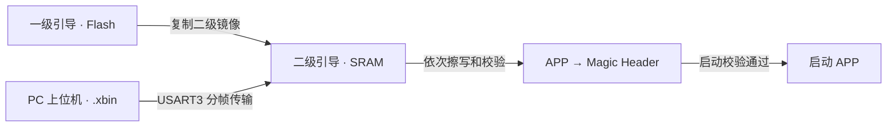

# BOOT2

面向 **STM32F407VE** 的两级串口 Bootloader。一级引导从 Flash 启动，二级引导在 RAM 中通过串口接收、写入和校验固件，并启动更新后的 APP。


单包耗时按原始时序图比较。接收下一包时可并行写入上一包，约 **16.77 ms** 的 Flash 写入时间被重叠，原图标注单包耗时缩短约 **33.8%**。[异步化前时序](docs/项目展示图/ramboot异步化前时序图.png) · [异步化后时序](docs/项目展示图/ramboot异步化后时序图.png)

以 **2 Mbaud** 升级 **335.18 KiB** 的 `.xbin`，20 次实板升级的协议耗时均值为 **6.672 s**，P95 为 **6.761 s**，平均有效吞吐为 **50.24 KiB/s**。[逐次计时](docs/benchmarks/upgrade-protocol-samples.csv)

## 主要特性

- **两级引导与 RAM Boot。** 改造 ST 启动文件和链接脚本，由 Makefile 构建完整引导镜像。一级将二级镜像从 Flash 搬到 SRAM，二级在 SRAM 中运行升级逻辑，避开 Flash 忙时从同一片 Flash 取指带来的停顿。
- **定制协议与接收流水线。** 借鉴 Modbus RTU 的请求–应答方式，设计带命令、长度、载荷和 CRC16 的类 TLV 帧。RXNE 中断接收帧字段和普通载荷，DMA 搬运 `PROGRAM` 载荷。FreeRTOS 通过空闲、解析和烧写三条队列复用 10 个包缓冲，将命令解析与 Flash 写入交给独立任务。
- **Flash 分区防护与分层校验。** 擦除、烧写命令保护两级 Boot 所在的前 48 KiB。传输用 CRC16 校验单帧，写入后用 CRC32 校验 APP 和 Magic Header，启动前再次检查头部与镜像。
- **启动拦截与单帧重传。** 复位时长按升级键、启动窗口收到串口数据或镜像校验失败都会让设备留在 Boot。跳转时切换 `VTOR`，由汇编从 APP 向量表加载 `MSP` 和复位入口。TIM6 定期检查接收状态，帧内超时达到 60 ms 时中止当前接收并复位状态机，主机可重传这一帧。
- **配套打包、分发与实板测试。** AI 辅助开发 Python 打包脚本、C# WinForms 上位机和实板测试工具，覆盖编译 APP、封装 `.xbin`、串口分发和测试验证。

## 快速开始

需要 STM32F407VE 实板、SWD 下载器和支持 2 Mbaud 的 3.3 V USB 转串口。Bootloader 使用 Linux 或 WSL、GNU Make 和 Arm GNU Toolchain 构建。

从 Release 下载 Windows x64 上位机与示例 `.xbin`。上位机运行需 .NET 10 Desktop Runtime（x64）。[下载上位机](https://github.com/Flipped2006/BOOT2/releases/download/v0.0.1/SERIAL_UPDATER.exe) · [下载示例固件](https://github.com/Flipped2006/BOOT2/releases/download/v0.0.1/stm32f407_demo_magic_header.xbin) · [.NET 10 下载页](https://dotnet.microsoft.com/zh-cn/download/dotnet/10.0)

### 1. 构建并烧录 Bootloader

安装 `arm-none-eabi-gcc` 后，获取源码并构建。

```bash
git clone https://github.com/Flipped2006/BOOT2.git
cd BOOT2
make -j4
```

可用 `make -j4 GCC_PATH=/path/to/arm-gnu-toolchain/bin` 指定工具链目录。

通过 SWD 烧录 `build/boot1st.hex`。使用 `.bin` 烧录时，将 `build/boot1st.bin` 写入 **`0x08000000`**。这两个 Flash 镜像都已内嵌二级引导。调试 RAM 中的二级引导时可使用 `build/boot.elf` 的符号。[一级引导构建与验证](boot1st/README.md)

### 2. 连接升级串口与日志串口

USB 转串口的 TX 接板端 RX，RX 接板端 TX，并连接 GND。

| 用途 | 板端引脚 | 串口配置 |
| --- | --- | --- |
| 固件升级 | `USART3`，`PB10` TX / `PB11` RX | `2,000,000` baud，8N1 |
| 查看日志 | `USART1`，`PA9` TX / `PA10` RX | `115,200` baud，8N1 |

板上已有可启动的 APP 时，复位后按住 `KEY2`（`PC4`，低电平有效）约 3 秒，等日志出现 `enter boot mode` 后松开。

### 3. 发送示例固件

打开 `SERIAL_UPDATER.exe`，选择升级串口和下载的 `.xbin`，点击 **升级**。上位机会依次写入并校验 APP 和 Magic Header，再发送 `BOOT`。在 USART1 上确认 APP 的启动日志 `[SYSTEM]: Build Date:`。

示例 APP 会连接 SSID 为 `BOOT2LAB`、密码为 `boot2lab` 的 2.4 GHz 演示热点。连接成功后，串口会周期性输出 `[WiFi INFO]`。

<details>
<summary>从源码打包 APP 与运行上位机</summary>

若已有配套工程，用 Keil MDK 打开 `STM32F4_EASYLOGGER_BOOT/mdk/stm32f407.uvprojx`。APP 链接起始地址为 `0x08010000`。构建后脚本生成 `.xbin`，也可在 APP 工程根目录手动打包已有的 `.bin`。

```powershell
python .\script\gen_magic_header.py .\mdk\Objects\stm32f407.bin
```

生成文件 `generate/stm32f407_magic_header.xbin` 含 4 KiB 的头部区域与 APP 二进制。已有 `SERIAL_UPDATER` 源码时，可安装 .NET 10 SDK 并在上位机工程目录执行以下命令。

```powershell
dotnet run --project SERIAL_UPDATER.csproj
```

</details>

## 启动与升级流程



普通 `PROGRAM` 包入队后即可应答，让下一包接收与上一包写入重叠。每个写入阶段的最后一包等累计写入完成再应答，随后由 `VERIFY` 校验 Flash 内容。

| Flash 区域 | 起始地址或位置 |
| --- | --- |
| 一级引导 | `0x08000000` |
| 二级镜像 | 紧接一级引导，4 字节对齐，启动时搬至 `0x20000000` |
| Magic Header | `0x0800C000` |
| APP | `0x08010000` |

## 实板验证

2026-11-19 在 STM32F407VE 上使用 4 KiB 数据块测试。`.xbin` 由 339,124 字节 APP 与 4,096 字节头部组成。协议计时从开始 APP 更新到 Magic Header 校验完成，包含请求、擦除、分块写入和校验。[实板测试方法](tests/hil/README.md)

| 测试 | 通过 / 样本 | 通过条件 |
| --- | ---: | --- |
| 正常升级 | 20 / 20 | 两区校验通过，J-Link 读回一致，Boot 镜像保持完整，新 APP 启动并输出周期日志 |
| 普通帧截断后重传 | 10 / 10 | 超时后重传原帧，正确返回版本 |
| 固件帧截断后重传 | 10 / 10 | 超时后重传原帧，Flash 读回及 CRC32 校验通过 |
| CRC16 坏帧拦截 | 10 / 10 | 损坏帧被拒绝，正确的对照帧可写入 |
| CRC32 坏镜像拦截 | 10 / 10 | `VERIFY` 拒绝损坏镜像，设备留在 Boot |

### SWD 复位与升级复测

2026-11-20 使用 335.18 KiB 的开发测试镜像，在 2 Mbaud 和 4 KiB 分块条件下完成 100 轮复测。每轮先用 J-Link 经 SWD 复位，再重做擦除、写入、校验、Flash 读回和 APP 启动检查。

- **Flash 读回与 APP 启动标记均为 100/100。** 每轮的 Boot 区、Magic Header 和 APP 读回内容均一致。
- **完整判据通过 99/100。** 一轮已输出 APP 启动标记，40 秒内观察到 0 条 `[WiFi INFO]`，未达到至少 3 条的判据。
- **共 102 次尝试。** 有 2 次 J-Link 在复位前连接失败，恢复连接后补齐了测试。

通过完整判据的 99 轮，协议耗时均值 **6.700 s**，P95 **6.788 s**。[复测逐轮记录](docs/benchmarks/reset-upgrade-100.csv)

## 相关文档

- [一级引导、向量表与链接检查](boot1st/README.md)
- [串口接收状态机与 DMA](docs/receive-state-machine.md)
- [完整数据流与源码位置](docs/project-data-flow.md#总数据流图)
- [实板测试配置与运行步骤](tests/hil/README.md)

## 许可证

BOOT2 自有代码采用 MIT 许可证。第三方组件的许可见各组件源码中的声明。[MIT 许可证](LICENSE)
