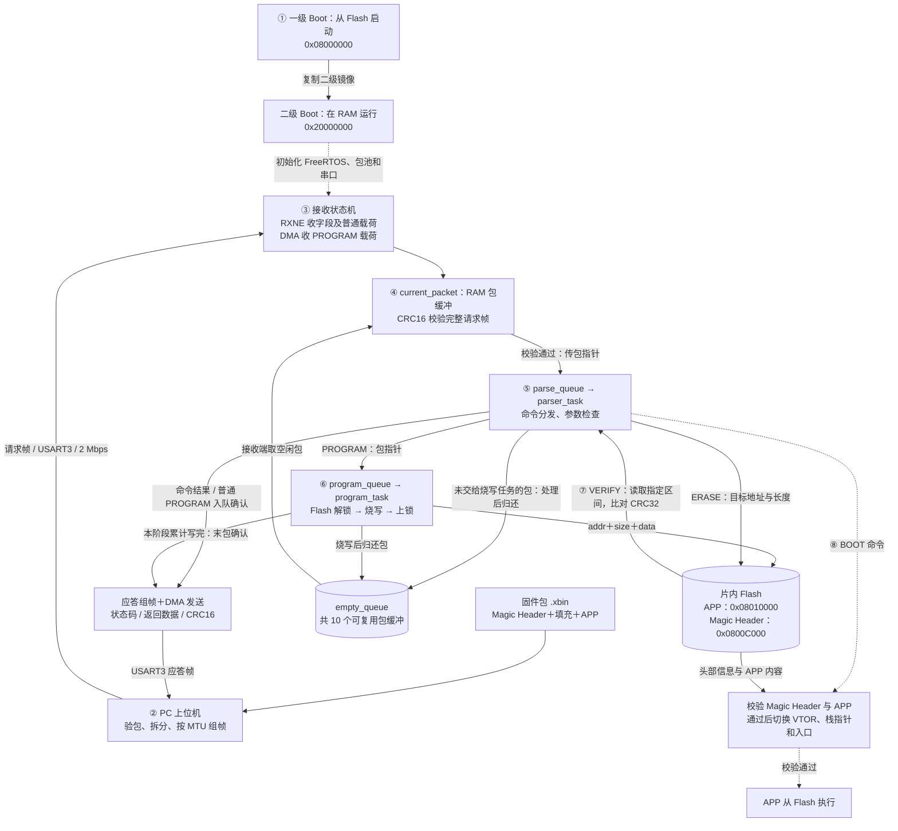

# 项目数据流图与面试讲稿

依据 BOOT2 工作区源码与配套 SERIAL_UPDATER 上位机核对，日期：2026-11-17。

记忆顺序：**搬、拆、收、验、排、写、核、跳。**

## 总数据流图

实线表示数据、结果或包缓冲指针的流转；虚线表示启动与跳转控制。⑤、⑥分别合并展示队列和消费该队列的任务。



## 对应的升级命令顺序

上位机采用请求—应答方式推进。写入阶段的 FWINFO、MHINFO、ERASE、PROGRAM 或 VERIFY 返回失败时，界面流程退出当前升级。

```text
查询 VERSION 和 MTU
    ↓
REQUEST / FWINFO：声明 APP 总长度，复位固件计数
    ↓
APP：ERASE → 分块 PROGRAM → VERIFY（CRC32）
    ↓
REQUEST / MHINFO：声明头部区域总长度，复位头部计数
    ↓
Magic Header 区域：ERASE → 分块 PROGRAM → VERIFY（CRC32）
    ↓
BOOT：板端再次检查头部与 APP，检查通过后跳转
```

APP 先写并验证成功，再写 Magic Header。头部记录固件类型、偏移、地址、长度、CRC32、版本以及头部自身的地址和 CRC32。

## 面试背诵稿

我的项目是基于 STM32F407 的两级串口 Bootloader。整个数据流我分成八步：搬、拆、收、验、排、写、核、跳。

第一步是搬。上电后一级 Boot 从 Flash 启动，把二级 Boot 镜像复制到 RAM，再切换向量表、装载二级栈指针和入口，让二级 Boot 在 RAM 中运行，并初始化 FreeRTOS、串口和包缓冲池。

第二步是拆。PC 上位机读取 xbin 固件包，检查头部和固件 CRC，拆出 APP 和头部区域，查询板端版本及 MTU，再按 MTU 把数据组织成带命令、长度和 CRC16 的请求帧。升级顺序是先处理 APP，再处理 Magic Header。

第三步是收。请求帧通过 USART3 发到板端。接收状态机用 RXNE 中断处理帧头、命令、长度和 CRC 等字段；PROGRAM 的大块载荷交给 DMA，直接放进当前 RAM 包缓冲，DMA 完成后继续接收帧尾 CRC。

第四步是验。板端在接收回调中计算 CRC16，检查这一帧传输是否完整。校验失败就丢弃这一帧；通过后将包指针交给 parse_queue。

第五步是排。parser_task 从队列取包，分发命令并检查参数。查询、升级信息设置、擦除和 VERIFY 在解析任务中处理；合法的 PROGRAM 包继续把指针交给 program_queue。队列之间传的是指针，包数据保留在原缓冲中。

第六步是写。program_task 取出烧写包，根据地址和长度解锁 Flash、写入数据、再上锁，处理后把缓冲归还 empty_queue。接收端再从空闲队列取包复用，一共预分配十个包。普通 PROGRAM 包入队后就应答，让上位机继续发下一块；本阶段最后一个包要等累计数据全部写完才应答。

第七步是核。上位机发送 VERIFY，板端从 Flash 读取指定区间、计算 CRC32，与上位机给出的值比较，再将结果组帧，经发送 DMA 和 USART3 返回。APP 校验通过后，上位机按相同流程更新并校验 Magic Header。

第八步是跳。上位机发送 BOOT 命令，板端检查 Magic、头部 CRC32 和 APP CRC32；检查通过后关闭相关外设及 SysTick，设置 APP 向量表，并从 APP 向量表装载栈指针和复位入口，最终进入 APP。校验失败就留在 Boot。

## 需要讲准的实现细节

| 项目 | 当前代码行为 |
| --- | --- |
| 升级串口 | USART3，PB10 TX / PB11 RX，2 Mbps、8N1 |
| 日志通道 | EasyLogger → console_write → USART1，115200 bps |
| 请求帧 | `AA + opcode(1) + len(2) + payload(N) + CRC16(2)` |
| 应答帧 | `55 + opcode(1) + errcode(1) + len(2) + data(N) + CRC16(2)` |
| 字节序 | 当前 PC 和板端实现中的长度、地址、大小、CRC 数值按小端编码 |
| PROGRAM 载荷 | `addr(4) + size(4) + data`，MTU 为 4104 字节，其中数据最多 4096 字节 |
| 接收方式 | 协议字段和普通命令载荷使用 RXNE；PROGRAM 载荷使用 DMA1 Stream1 Channel4 |
| 发送方式 | USART3 TX 使用 DMA1 Stream3 Channel4；二值信号量用于等待 DMA 完成 |
| 包池和队列 | 启动时分配 10 个包对象，3 个队列都保存 `queue_packet_t *`；接收和任务之间交接缓冲所有权 |
| CRC16 | 接收回调校验请求帧；应答帧也附带 CRC16，检查的是帧级传输完整性 |
| CRC32 | VERIFY 检查指定 Flash 区间；BOOT 还检查头部自身 CRC32 和头部记录的 APP CRC32 |
| 两个 PROGRAM 计数 | received_size 表示已接收并送入烧写队列的数量；programed_size 表示累计完成写入调用的数量；头部有独立计数 |
| PROGRAM 应答时机 | 普通包由 parser_task 入队后应答；末包由 program_task 在累计写入达到本阶段长度后应答；最终以 VERIFY 确认内容 |
| BOOT 应答时机 | BOOT 的 OK 在头部及 APP 检查之前发出；APP 是否实际运行还需观察应用侧表现 |
| 启动地址 | 一级 Boot：0x08000000；二级 Boot 的 RAM 地址：0x20000000；头部：0x0800C000；APP：0x08010000 |

本图展示 `BOOT` 命令触发的跳转。复位时，KEY2 长按、镜像校验失败或启动窗口内收到串口数据都会让设备留在 Boot，其余情况下会自动尝试启动 APP。普通 `PROGRAM` 包应答表示已入队，写入内容由 `VERIFY` 确认。发送信号量用于等待 DMA 完成。

## 源码对应位置

| 图中部分 | 文件和入口 |
| --- | --- |
| 一级搬运与进入二级 | `boot1st/boot1st.s:Reset_Handler`、`boot1st/boot1st.ld` |
| RAM 运行地址 | `platforms/cmsis/device/stm32f407xx_ram.ld` |
| RTOS 与包池初始化 | `app/main.c:main`、`app/bootloader.c:bootloader_main` |
| 接收状态机与 CRC16 | `app/bootloader.c:bl_usart_rx_handler`、`bl_usart_rx_async_handler` |
| RXNE 和 DMA 收发 | `driver/bl_usart.c:USART3_IRQHandler`、`DMA1_Stream1_IRQHandler`、`DMA1_Stream3_IRQHandler` |
| 分发、计数、末包确认 | `app/bootloader.c:parser_task`、`bl_opcode_program_handler`、`run_program`、`program_task` |
| Flash 擦写 | `driver/stm32_flash.c:stm32_flash_erase`、`stm32_flash_program` |
| VERIFY 和 APP 检查 | `app/bootloader.c:bl_opcode_verify_handler`、`application_valid_check`、`app_application` |
| 头部格式与检查 | `app/magic_header.c` |
| APP 入口切换 | `app/jumpapp.s:JumptoApp` |
| 上位机的验包与升级编排 | 配套 `SERIAL_UPDATER/MagicHeader.cs:Parse`、`Form1.cs:buttonUpgrade_Click` |
| 上位机分块、组帧与应答 | 配套 `SERIAL_UPDATER/Transfer.cs:PROGRAM`、`BuildPacket`、`WaitResponse` |

核对时以工作区实现为准。现有说明文件中部分参数为旧版本，背诵时使用本图对应的源码行为。
